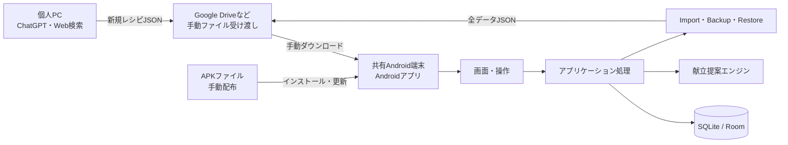
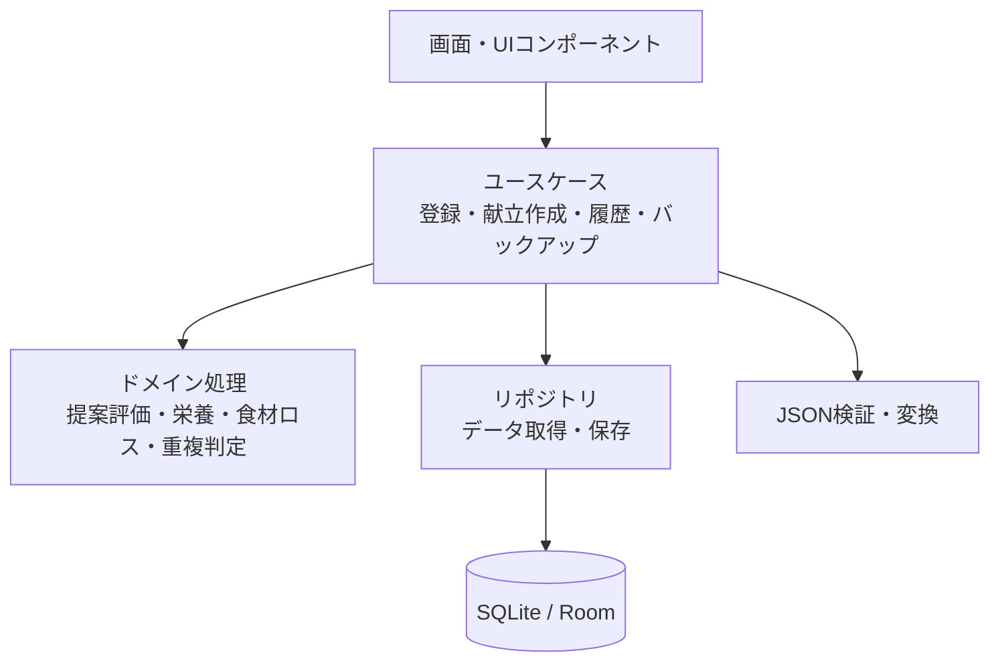
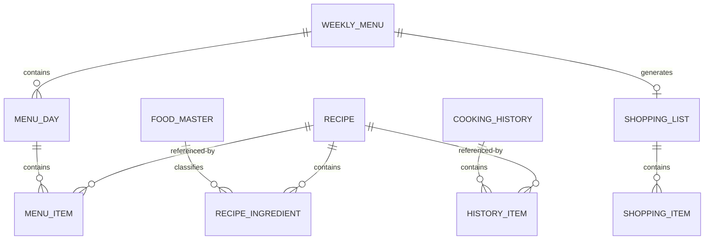

# レシピ管理アプリ 概要設計書

## 1. 文書情報

- 文書名: レシピ管理アプリ 概要設計書
- 対象工程: 概要設計
- 前提文書: `document/REQUIREMENTS.md`
- ステータス: 承認済み（Kotlin／Androidネイティブ版）
- Issue 1: 2026-09-23の要件承認・次工程への指示を受け、第18章に変更概要設計を整理した。第2～17章はv1.00の基準設計。第18章は2026-10-02の次工程指示により承認済み。残る表示・配色・フォント・実装順の具体化は詳細設計レビューへ引き継ぐ。

## 2. 設計方針

- 共有Android端末を唯一のデータ正本とする。
- アプリはKotlinで実装したAndroidネイティブアプリとして提供する。
- アプリ本体はAPKとして共有端末へインストールし、バックエンドサーバおよび外部データベースを使用しない。
- ユーザーデータは共有端末のアプリ専用領域にあるSQLiteデータベースだけに保存する。
- 個人PCは、ChatGPTなどで新規レシピ登録用JSONを作成する用途に限定する。
- Google DriveなどはJSONファイルの手動受け渡しにのみ使用し、API連携や自動同期は行わない。
- レシピの削除は論理削除とし、データ間の参照を維持する。
- バックアップおよび復元は全データを対象とする。

## 3. システム構成



### 3.1 配置方針

| 対象 | 配置先 | 内容 |
| --- | --- | --- |
| アプリ本体 | APKファイル | Kotlinコード、画面、内蔵マスター |
| 通常データ | 共有端末のアプリ専用SQLite | レシピ、献立、履歴、買い物リスト、設定など |
| 新規レシピ登録ファイル | Google Driveなど | 個人PCから共有端末へ渡す一時的なJSON |
| バックアップ | 共有端末およびGoogle Driveなど | 全データを含むJSON |

APKは`dst/`へ出力し、USB、Google Driveなどを介して共有端末へ手動で渡す。外部サービスにユーザーデータを保存しない。公開やGitHubへのPushは、ユーザーから明示的な指示を受けた場合だけ行う。

### 3.2 Androidでの導入・起動方法

- 開発PCで署名済みAPKを生成し、Google DriveやUSBなどで共有端末へ渡す。
- 初回はAndroid側で配布元に対する「不明なアプリのインストール」を一時的に許可し、APKを開いてインストールする。
- 通常はAndroidホーム画面またはアプリ一覧のアイコンから起動する。
- 更新版は同じアプリIDと署名鍵で作成し、既存アプリへ上書きインストールする。
- アプリ更新前、特にDB移行を伴う更新前には全データのバックアップを案内する。
- APKの取得以外の基本機能は、インターネット接続なしで利用できる。

### 3.3 アプリ更新・再インストール

- 同じアプリIDと署名鍵による上書き更新では、原則として端末内データを維持する。
- 署名鍵は初回リリース後に変更・紛失しないよう、安全に保管する。
- アプリをアンインストールするとアプリ専用領域のデータも削除されるため、アンインストール前に全データをバックアップする。
- アプリIDまたは署名鍵を変更する場合は別アプリとして扱われるため、旧アプリでバックアップし、新アプリで復元する。

## 4. 技術構成

| 区分 | 採用技術 | 採用理由 |
| --- | --- | --- |
| UI | Jetpack Compose + Material 3 | Kotlinで画面と状態を一貫して実装でき、Androidの操作体系に合わせやすい |
| 言語 | Kotlin | Android公式推奨言語で、型安全にデータと業務ロジックを扱える |
| ビルド | Gradle（Kotlin DSL） | Android公式のビルド、テスト、APK生成に対応する |
| 対応OS | Android 8.0（API 26）以上 | 共有端末との互換性を確保しつつ、現在のAndroid APIを利用しやすい |
| 画面遷移 | Navigation Compose | 戻る操作と画面遷移をAndroid標準の構成で管理できる |
| ローカルDB | SQLite + Room | 構造化データ、索引、トランザクション、DB移行を型安全に扱える |
| JSON処理 | kotlinx.serialization + Draft 2020-12対応JSON Schema検証ライブラリ | JSONの変換とSchema検証をKotlin側で実施する |
| 単体・DBテスト | JUnit + kotlinx-coroutines-test + Room Test | 献立評価、Import、復元、日付処理、DB処理を検証する |
| UIテスト | Compose UI Test | Android画面で主要操作を自動検証する |

ライブラリの具体的なバージョンは、実装開始時に公式の安定版を確認して固定する。JSON Schema検証ライブラリはDraft 2020-12、ローカル`$ref`、`uuid`、`date`、`date-time`、`uri`のformat検証に対応するものを採用し、採用前に本プロジェクトのSchemaで互換性テストを行う。

## 5. アプリケーション構成

### 5.1 レイヤー



- UIからRoom DAOを直接操作しない。
- 献立提案と評価は画面から独立した純粋なロジックとして実装する。
- 保存・Import・復元はトランザクションで処理し、途中失敗時に一部だけ反映されないようにする。
- データ形式とDBスキーマには、それぞれ独立したバージョンを持たせる。

### 5.2 主要モジュール

| モジュール | 責務 |
| --- | --- |
| Recipe | レシピの登録、編集、検索、論理削除、復元 |
| Recipe Import | 新規レシピJSONの検証、プレビュー、重複判定、一括登録 |
| Menu Planner | 対象日の決定、献立自動提案、手動変更、再評価 |
| Cooking History | 調理実績、献立履歴、最終調理日の再計算 |
| Shopping List | 献立からの材料集約、購入不要・購入済み管理 |
| Nutrition | 食材の食品群分類と大まかな栄養評価 |
| Food Loss | 共通食材、販売単位、使い残しの評価 |
| Calendar | 土日、祝日、ご飯不要日の判定 |
| Backup | 全データExport、検証、形式変換、復元 |
| Settings | バックアップ通知、内蔵マスター情報、表示設定 |

## 6. 画面構成

### 6.1 画面一覧

| 画面 | 主な機能 |
| --- | --- |
| ホーム | 今週の献立、未設定日、ご飯不要日、バックアップ通知の表示 |
| 献立作成 | 対象週選択、自動提案、日・料理単位の変更、警告表示、保存 |
| 献立詳細 | 日ごとの料理、材料、調理実績登録、作り方URL表示 |
| 献立履歴 | 日付・週単位の履歴表示、修正、削除 |
| レシピ一覧 | 検索、カテゴリ・時間・手間・状態による絞り込み |
| レシピ詳細 | 材料、栄養目安、調理情報、最終調理日、URL、メモの表示 |
| レシピ編集 | 新規登録、編集、論理削除、復元 |
| レシピImport | JSON選択、検証結果、重複候補、プレビュー、一括登録 |
| 買い物リスト | 材料集約、利用料理、購入不要・購入済みの切り替え |
| ご飯不要日 | 日付、理由・メモの登録、変更、削除 |
| データ管理 | バックアップ、復元、最終バックアップ日時、容量表示 |
| 設定 | バックアップ通知間隔、マスター確認、アプリ情報 |

### 6.2 ナビゲーション

スマートフォンでは、主要機能を下部ナビゲーションに配置する。

- ホーム
- 献立
- レシピ
- 買い物
- その他（履歴、Import、データ管理、設定）

### 6.3 主要な警告

- 自動提案条件を緩和した場合
- 手動変更後に手間、重複、栄養、食材ロスの条件から外れた場合
- 削除済みレシピが保存済みの未来の献立に含まれる場合
- 復元によって全データが置き換わる場合
- Importファイルにエラー、重複、参照切れ、非対応バージョンがある場合
- 最終バックアップから設定期間が経過した場合

## 7. データ設計概要

### 7.1 エンティティ関連



### 7.2 主要データ

| データ | 主な項目 |
| --- | --- |
| Recipe | ID、料理名、カテゴリ、調理時間、手間、URL、メモ、最終調理日、状態、作成・更新日時 |
| RecipeIngredient | ID、Recipe ID、材料名、正規化名、分量、単位、Food Master ID |
| WeeklyMenu | ID、週開始日、作成日時、更新日時 |
| MenuDay | ID、Weekly Menu ID、日付、ご飯不要フラグ、理由・メモ |
| MenuItem | ID、Menu Day ID、Recipe ID、料理名スナップショット、献立上の役割 |
| CookingHistory | ID、調理日、作成・更新日時 |
| HistoryItem | ID、History ID、Recipe ID、料理名スナップショット、献立上の役割 |
| ShoppingList | ID、対象週、生成元献立更新日時、作成日時 |
| ShoppingItem | ID、材料名、分量、単位、利用料理、購入不要、購入済み |
| FoodMaster | ID、標準名、販売単位、主要食材フラグ、利用者編集フラグ |
| FoodMasterAlias | Food Master ID、別名、正規化別名 |
| FoodMasterGroup | Food Master ID、食品群 |
| FoodMasterSeason | Food Master ID、旬の月 |
| AppSettings | バックアップ通知間隔、最終バックアップ日時、祝日データ版 |
| AppMetadata | DBスキーマ版、バックアップ形式版、アプリ版。端末側の運用情報でありバックアップ復元対象外 |

### 7.3 IDと参照

- IDにはUUIDを使用し、端末内で重複しない値を生成する。
- 新規レシピJSONにはアプリ内IDを持たせず、共有端末への登録時に付与する。
- 献立と履歴はRecipe IDに加え、登録時点の料理名をスナップショットとして保持する。
- レシピを論理削除してもIDと参照は維持する。
- 削除済みレシピは通常検索と候補選択から除外し、削除済み検索から復元できる。
- 削除済みレシピが未来の献立に含まれる場合は、献立上に警告を表示して変更を促す。

## 8. 献立提案方式

### 8.1 対象日の決定

1. 対象週の月曜日から金曜日を列挙する。
2. 内蔵祝日マスターに含まれる日を除外する。
3. ご飯不要日を除外する。
4. 残った日を献立提案対象とする。

### 8.2 候補抽出

- 利用中のレシピだけを候補とする。
- 一品もの、または主菜・副菜・汁物の構成候補を作る。
- 2週間以内に調理した料理は、初期候補から除外する。
- レシピ不足時は、条件の優先順位に従って除外条件を緩和する。

### 8.3 評価順序

献立構成を必須条件とし、それ以外を次の優先順で評価する。

1. 手間の分散
2. 2週間以内の重複回避
3. 栄養バランス
4. 食材ロス
5. 旬

手間レベルを主評価、調理時間を補助評価とする。具体的な点数、閾値、同点時の選択方法は詳細設計で定義する。

### 8.4 条件緩和

- 候補不足時は、旬、食材ロス、栄養、重複回避の順で条件を緩和する。
- 献立構成と削除済み除外は緩和しない。
- 手間の条件は構成可能性を損なわない範囲で維持する。
- 緩和した条件と理由を提案結果に表示する。

### 8.5 手動変更

- 日単位の再提案と料理単位の変更を提供する。
- 変更後に手間、重複、栄養、食材ロスを再評価する。
- 警告があっても、利用者の判断で保存できる。

## 9. 栄養・旬・食材ロスの扱い

### 9.1 栄養

- 材料を食品群へ分類し、レシピが主要食品群を含むかを表示する。
- 厳密なカロリーや栄養素量は計算しない。
- 週間評価では、対象日全体の食品群の偏りを確認する。

### 9.2 旬

- 日本国内の一般的な旬を月単位でFood Masterへ保持する。
- 旬情報がない材料は評価対象外とし、レシピ自体は候補に残す。

### 9.3 食材ロス

- 材料名と単位を正規化し、同一食材の利用量を週単位で集計する。
- 共通食材を複数料理で使用する組み合わせを優先する。
- 販売単位が登録されている食材は、想定残量を補助評価に用いる。
- 単位変換できない材料は無理に合算しない。

## 10. Import設計

### 10.1 新規レシピ登録用JSON

- JSON Schema、サンプルJSON、ChatGPT用プロンプトを同じバージョンで管理する。
- 入力項目は料理名、2人分の材料、カテゴリ、調理時間、手間、URL、メモを基本とする。
- ID、状態、作成・更新日時、栄養評価はImportファイルから受け取らず、共有端末で生成する。
- 最終調理日は原則としてImport対象外とし、必要な場合は共有端末で初回入力する。

### 10.2 Import手順

1. ファイル形式とJSON Schemaを検証する。
2. ファイル全体の検証結果とは別に、各レシピを個別検証し、正常なレシピを登録候補として残す。
3. 材料、カテゴリ、単位などを正規化する。
4. 料理名、参照元URL、主要材料を用いて重複候補を抽出する。
5. 追加、スキップ、削除済みレシピの復元を利用者が選択する。
6. 登録対象へ新しいUUIDを付与する。
7. 1トランザクションで登録する。
8. 成功件数とエラー内容を表示する。

削除済みレシピを復元する場合、状態だけを利用中へ戻し、Import内容で既存項目を上書きしない。

## 11. バックアップ・復元設計

### 11.1 バックアップ

- データ管理画面の「バックアップ」ボタンから実行する。
- 利用者の1回の操作で全データJSONを生成し、Androidのファイル選択画面で指定した場所へ保存する。
- ファイル名は `recipe-manager-backup_YYYY-MM-DD_HHmmss.json` とする。
- バックアップ形式版、作成日時、アプリ版をメタデータへ含める。
- 前回バックアップ日時は、利用者が指定した保存先へのファイル書き込みが完了した後に更新する。
- 自動バックアップおよびGoogle Driveへの自動保存は行わない。

### 11.2 復元

1. JSON構文、形式版、必須データ、ID参照を検証する。
2. 対応可能な旧形式は現在形式へメモリ上で変換する。
3. 復元内容と全件置換されることを表示する。
4. 現在データのバックアップを利用者へ促す。
5. 利用者の確認後、1トランザクションで全データを置換する。
6. 履歴があるレシピの最終調理日を履歴から再計算する。
7. 履歴がないレシピはバックアップ内の最終調理日を採用する。
8. 最終バックアップ日時はバックアップファイル直下の`createdAt`を採用する。

バックアップ形式版、作成元アプリ版、マスター版はファイル直下のメタデータを唯一の正とする。端末側のDBスキーマ版などの運用メタデータは復元せず、現在のアプリが管理する値を維持する。

非対応の新形式、破損、参照切れ、変換失敗がある場合は、現在データを変更せず復元を中止する。

## 12. Androidアプリ・オフライン設計

- アプリ名、アイコン、アプリID、対応AndroidバージョンをAndroid ManifestとGradleへ定義する。
- アプリIDおよびKotlin名前空間は`jp.local.recipemanager`、表示名は「レシピ管理」とする。
- アプリ本体と内蔵マスターはAPKに同梱する。
- Web検索と外部URL表示を除き、基本機能をオフラインで利用できるようにする。
- 更新版APKは同じアプリIDと署名鍵で生成し、上書きインストールできるようにする。
- 署名鍵ファイルとパスワードはリポジトリおよび配布APKへ含めず、開発PC上のリポジトリ外の安全な場所で管理する。
- 署名鍵ファイルは暗号化された別媒体にもバックアップし、鍵の所在と復旧手順を利用者だけが参照できる形で記録する。
- Gradleへ渡す署名情報は、リポジトリ外のユーザー用Gradle Propertiesまたは環境変数から読み込む。
- DB移行が必要な更新は、RoomのMigrationを使用してトランザクション内で実行する。
- DB移行に失敗した場合は、移行途中の状態を保存せず、可能な限り更新前のデータを維持する。
- 大規模または互換性に影響するDB移行では、アプリ更新前に全データのバックアップを利用者へ促す。
- DB移行処理は、旧バージョン相当のテストデータを使って検証してから公開する。
- アプリのデータ消去とアンインストールでデータが失われること、およびバックアップの必要性をデータ管理画面に表示する。

## 13. セキュリティ・データ保護

- Import値は画面表示時にHTMLとして解釈せず、文字列として扱う。
- URLはHTTPまたはHTTPS形式を検証し、外部サイトであることが分かる形で開く。
- JSON Schema検証に失敗したデータは保存しない。
- Importと復元は、検証完了後にトランザクションで実行する。
- エラー発生時は既存データを維持する。
- ユーザーデータを外部サービスへ自動送信しない。

## 14. テスト方針

| 種別 | 主な対象 |
| --- | --- |
| 単体テスト | 献立評価、条件緩和、栄養、食材ロス、日付、重複判定、最終調理日再計算 |
| DBテスト | CRUD、論理削除、トランザクション、DBバージョン移行 |
| JSONテスト | 正常Import、部分エラー、重複、破損、旧形式変換、参照切れ |
| UIテスト | レシピ管理、献立提案・変更、履歴、買い物、バックアップ・復元 |
| Androidテスト | APKインストール、オフライン起動、上書き更新、DB移行、アンインストール注意表示 |
| 性能テスト | レシピ500件、履歴5年分、提案5秒以内、100件Import10秒以内 |

性能測定の基準環境は、Android 8.0（API 26）、CPU 4コア、メモリ4GBのAndroid Emulatorとする。実端末確認では、これと同等以上の端末を使用し、端末名、OS版、空き容量をテスト結果へ記録する。

## 15. ソースコード配置方針

`src/`をAndroidプロジェクトルートとし、主要なKotlinコードは以下の責務で分割する。

```text
src/
├─ settings.gradle.kts
├─ build.gradle.kts
└─ app/
   ├─ build.gradle.kts
   └─ src/
      ├─ main/
      │  ├─ kotlin/.../
      │  │  ├─ app/       # 起動、ナビゲーション、全体テーマ
      │  │  ├─ feature/   # recipe、menu、history、shopping、backup、settings
      │  │  ├─ domain/    # モデル、ルール、提案・評価ロジック
      │  │  ├─ data/      # Room、Repository、ファイル
      │  │  └─ core/      # 共通UI、JSON、日時、エラー処理
      │  ├─ assets/       # 祝日、食材などの内蔵マスター
      │  └─ res/          # アイコン、文字列、テーマ
      ├─ test/            # JVM単体テスト
      └─ androidTest/     # Room・Compose UIテスト
```

Gradleの配布用タスクで署名済みAPKを`dst/`へコピーする。通常の中間生成物は`src/app/build/`へ生成し、Git管理対象外とする。

## 16. 詳細設計で確定する事項

- 各画面の項目、操作、画面遷移、エラー表示
- Roomのテーブル、索引、型、DB移行手順
- APK更新、アプリID・署名鍵変更時のバックアップ・復元手順
- 新規レシピ用およびバックアップ用JSON Schema
- ChatGPT用プロンプト本文
- 材料名・単位の正規化規則
- 食品群、旬、販売単位の内蔵マスター内容
- 献立提案の点数、閾値、同点時処理、条件緩和の詳細
- 重複候補の判定条件
- バックアップ通知間隔

## 17. 参考資料

- Android Developers Kotlin: https://developer.android.com/kotlin
- Jetpack Compose: https://developer.android.com/compose
- Room: https://developer.android.com/training/data-storage/room

## 18. Issue 1 変更概要設計（作成中）

### 18.1 対象と設計の境界

- 根拠は要件定義書第10章と、2026-09-23のユーザーによる要件承認・次工程への指示とする。
- 本章は変更の責務、データの流れ、既存設計への影響を整理する。Q-01～14の業務判断は要件第10.7・10.8節で確定済みとし、個別回答を統合する。
- CR-08の管理者モードは2026-09-23のQA回答で取り下げ、今回対象外とする。誤登録レシピはQA-7・8の条件を満たす場合だけ完全削除する。
- 取り下げたCR-08を除くIssue 1の変更を`v2.00`の1リリースにまとめる。リリース内の実装順序は未確定。詳細設計、Schema変更、実装、実行試験はこの成果物の対象外とする。
- 共有Android端末、夕食2人分、ローカル保存、オフライン利用を維持する。

### 18.2 モジュールと既存設計への対応

| 対象要求 | 担当モジュール・変更方針 | 既存節 | 確定待ち |
| --- | --- | --- | --- |
| CR-01・02・17 | 共通UIでランチャー・起動時ロゴの識別性、日本語表示、全画面での文字サイズ200%・TalkBack、操作領域、色以外の状態表示を扱う | 6、12、14 | 配色・フォントの具体値 |
| CR-03・04・14、BUG-01・03、DOC-05 | Food Master管理を主要機能に加え、下部ナビゲーションから検索・登録・編集・選択・別名・統合へ移動できるようにする。今回の変更では単位換算を行わず、同一材料かつ同一単位だけを合算する | 5～7、9 | なし |
| CR-05・10、BUG-04 | Cooking Historyが実際の調理日と最終調理日の整合性を管理する。予定、変更、未調理、延期、部分調理、実績を区別する | 6～7、11 | なし（QA-26～28・31～33で確定） |
| CR-06・07・19、BUG-02 | Calendarが7日分の初期要否と祝日情報を扱い、Menu Plannerが利用者指定と献立を管理する。祝日更新でも明示指定・保存済み献立・固定を維持する | 5～8 | なし（QA-41・42で確定） |
| CR-09・11・13、BUG-07・09 | Menu Plannerが固定を入力条件とする部分提案と採用前プレビューを提供し、候補不足と探索上の失敗を区別する | 7～8 | なし（QA-7～15、要件10.8で確定） |
| CR-12、BUG-05・06 | Shopping Listが生成元の変更検出と再生成時のチェック引継ぎ判定を担当する | 5、7、9 | なし（QA-19、要件10.8で確定） |
| CR-15、BUG-10・11 | Backupが新形式の一貫した読取、分類・参照・下書きの往復保持、読込量制限、保存結果の通知を担当する。更新直前に作るv1.00形式だけを変換対象とし、既存DBはRoom Migrationで保全する | 11、13 | なし（分類欠落は要件10.8で確定） |
| CR-16、BUG-08 | 各編集画面とRecipe Import・Menu Plannerが下書きを管理し、確定保存と区別する。3種類の下書きを再起動後も期限なく保持し、バックアップ対象とする | 5～6、10～11 | なし（QA-24・25・29・30で確定） |
| CR-18、DOC-01 | API 26・4GBのAndroid Emulatorと統一データ・操作で3回測定し、最遅値をAndroid上の合格値と比較する | 14 | なし（QA-38で確定） |
| CR-20、DOC-04 | 更新・配布手順でDebugからReleaseへの移行と同一署名更新を区別する | 3、12 | なし（18.11に方式を定義） |
| DOC-02・03 | JSON処理方式と旧ID互換規則を18.11に定め、既存ID・参照を保持する | 4、7、10～11 | なし（18.11に方針を定義） |
| CR-08 | 要求取り下げにより今回対象外 | 2、7、13 | なし（QA-6で確定） |

### 18.3 材料と数量の流れ

1. 材料マスタの検索・選択、または未登録材料の登録から、レシピの材料行へ関連付ける。
2. 材料の属性と、レシピで使用する分量・単位を別の情報として管理する。
3. 材料名・別名を解決し、同一材料かつ同一単位の量だけを合算する。単位換算は行わず、異なる単位は別項目として表示する。
4. 買い物集計と食材ロス評価は同じ材料識別規則を用いる。販売単位・販売量・換算値を管理せず、食材ロス評価は同じ材料を複数料理で再利用できるかを中心に行う。販売量から想定残量を計算しない。
5. アプリ同梱の内蔵材料マスタは変更・削除できないプリセットとする。利用者は不足する材料を利用者材料として追加でき、利用者追加分だけを編集・統合できる。プリセット本体を変えずに利用者別名を追加できる。
6. 利用者材料を統合した場合、既存レシピを含む全参照を統合先へ同一トランザクションで即時移行する。分量・単位・表示順・注記を維持し、買い物リストと食材ロス評価を更新必要状態にする。内蔵プリセット自体は統合元として変更・削除しない。

食品群の複数分類をバックアップでも保持する。旧形式で失われた分類は推測で復元しない。栄養は食品群による大まかな目安だけを扱い、カロリーや栄養素の数値は管理しない。材料マスタは名前、別名、食品群、基本単位、旬、主要食材フラグを管理する。販売単位、販売量、換算値、換算根拠は今回管理しない。

利用者追加材料は、どのレシピ等からも参照されていない場合だけ確認後に完全削除できる。参照中は削除を禁止して参照先と統合操作を案内する。削除は当該材料の利用者別名、食品群、旬などの専有データを含む単一トランザクションとし、内蔵プリセットを削除しない。

下部ナビゲーションは「ホーム・献立・レシピ・材料・その他」とする。ホームを起動画面として今週の献立、未設定日、バックアップ通知を表示する。買い物リストは献立画面と「その他」の両方から開けるようにする。

### 18.4 7日献立と提案の流れ

1. 対象週の月曜日から日曜日を表示する。初期要否は平日を必要、土日祝を不要とし、全曜日で利用者が切り替えられるようにする。
2. 週表示から理由・メモの入力や詳細画面への移動なしに要否を変更する。不要化後に取消通知が表示されている間だけ料理・固定を復元できる。通知終了または画面遷移後に必要へ戻した場合は未設定とする。旧理由・メモは参照可能な形で保全する。
3. 必要な日、日・料理単位の固定、利用中レシピ、実績、提案設定を入力として提案する。
4. 固定部分を維持した候補を作り、結果と警告を未確定の提案として表示する。固定した役割と不一致になるレシピカテゴリ変更は、該当固定の解除または献立変更まで禁止する。
5. 利用者が採用した時点で献立を保存する。採用前や取消では保存済み献立と買い物リストを変更しない。
6. 必要だが献立未設定の日を含む週も保存できる。買い物生成時は未設定日を警告し、設定済みの必要日の献立だけを集計する。休日であることだけを理由に除外しない。

候補不足は「レシピ0件」「構成に必要なカテゴリ不足」「条件による候補不足」を区別し、理由と登録導線を示す。探索の候補切捨てだけで不足・重複緩和を決定しない。具体的な探索改善は詳細設計で定め、BUG-07の5日・7日の回帰条件で検証する。

2週間回避は提案操作日ではなく各献立対象日を基準とし、過去0～13日の実績に加え、対象日の前後13日以内の別週の保存済み予定も対象とする。14日以上離れた実績・予定はこの条件では除外しない。過去週を対象とする自動提案・部分再提案は提供せず、履歴の参照・訂正・削除だけを許可する。

定番・お気に入り・頻度の個別項目は採用せず、提案優先度「高・普通・低・廃止」へ一本化する。初期値は「普通」とする。固定と献立構成などの必須条件、削除・廃止除外、2週間回避を先に適用し、残った候補を高、普通、低の順に優先する。「廃止」は新規の自動提案と手動選択から除外し、候補不足でも自動復活させない。履歴、保存済み献立、既存固定は維持し、固定部分を残した部分再提案を許可する。再利用する場合は先に優先度を戻す。祝日の収録年・未収録年を表示し、情報更新による保存済み献立・要否への反映規則はQA-42に従う。

### 18.5 調理実績と買い物リスト

- 最終調理日はレシピごとの実際の調理日の最大値から求め、履歴の保存日時を使わない。追加・訂正・削除に合わせて再計算する。新規の手入力欄を廃止する。QA-3で旧手入力値はDBからも完全破棄することが確定したため、旧情報の保持先や履歴への変換は設けない。履歴なし表示の文言は未確定とする。
- 通常の履歴削除には確認を設け、キャンセル時は保持する。「作らなかった」は予定側へ未調理として記録し、履歴・最終調理日を更新しない。3品の一部だけを作った場合は作った料理だけを履歴へ登録し、残りを未調理とする。予定と違う料理を作った場合は元の予定を「変更」として残し、実際のレシピの履歴と関連付ける。同じ調理日・同じレシピの実績は登録経路にかかわらず1件だけとする。
- 延期は元の予定へ記録し、延期先へ未確定予定を作る。延期先に既存献立があっても自動変更せず、延期予定を別に表示する。利用者が料理の入替えまたは延期取消を選び、構成と重複を再評価して確定する。未確定の延期予定は提案評価・買い物生成・実績登録の対象外とし、延期先で実際に作った時点で履歴へ登録する。
- 買い物の生成元情報は献立だけでなく、参照するレシピ材料・分量と関連マスタの変更を検出できるものにする。
- 再生成では購入済みと購入不要を別に扱う。同一材料で数量・単位が同じ場合と数量が減少した場合は購入済みを維持する。数量増加、単位変更、数量不明、材料統合では購入済みを解除する。購入不要は同一材料として追跡できる限り維持する。材料消失時は項目を除去し、全日不要の場合はリストを空にする。単位換算は行わないため、単位変更は常に購入済みを解除する。

### 18.6 入力途中・Import・バックアップ

- レシピ編集中データ、Import確認中データ、未採用提案を下書きとして確定データと分け、端末へ保存する。既存レシピは編集対象ごとに1件、新規レシピは1件、Import確認は1件、未採用提案は対象週ごとに1件を保持する。同じキーへの保存は既存下書きを置き換える。
- 下書きは確定保存、提案採用または明示破棄まで期限なく保持し、戻る・画面移動・中断・プロセス再生成・アプリ再起動後も再開できる。再開時と確定時には最新のレシピ、材料マスタ、献立との競合を再検証する。競合で確定不能でも自動削除せず、内容と破棄操作を示す。明示的に破棄する場合は確認し、確定データを変更しない。
- Import確認では料理名、材料・分量、カテゴリ、調理時間、手間、URLを修正できるようにし、修正後に入力検証・正規化・重複判定を再実行する。確定した内容のみ登録し、取消時には材料マスタを含め確定データを書き換えない。
- バックアップ対象を一貫した時点で読み取り、生成途中の更新が混在しないようにする。出力先への書込完了後に成功と最終バックアップ日時を更新し、失敗・キャンセルを区別する。
- 3種類の下書きについて、種類、内容、更新日時、必要な参照をバックアップ・復元対象に含める。復元後も下書きを確定データへ自動反映しない。
- 復元では提供元のサイズ情報だけに依存せず、読込中の累積量で50MB上限を検出する。全件展開前に超過を止め、検証・変換・参照確認が完了するまで既存データを置き換えない。
- 更新直前の保険として作成するv1.00バックアップ形式だけを旧形式変換の対象とする。それより古い試作形式は理由を表示して書込前に拒否する。v1.00形式と新形式の不要日＋料理や不完全な構成を、新仕様の未設定状態と混同して受け入れない。端末内の既存DBはバックアップ変換とは分け、Room Migrationで移行する。

### 18.7 データ移行と未確定事項の影響

| 確認事項 | 確定後に設計する内容 |
| --- | --- |
| Q-01・06 | CR-08を除くIssue 1を`v2.00`の1リリースにまとめ、管理者モードは対象外と確定。リリース内実装順序は未確定 |
| Q-02・07 | 食品群による栄養目安、変更不可の内蔵プリセット、利用者材料・別名の追加、編集・統合・削除、全参照の即時移行、買い物状態の引継ぎ、材料属性、換算なしをQA-16～23で確定 |
| Q-03 | 旧手入力日付をDB移行とv1.00バックアップ変換で破棄し、実際の履歴だけから再計算する。履歴なし表示の文言は未確定 |
| Q-04・14 | 必要／不要／未設定、取消、旧メモ、祝日更新時の明示指定・保存済み状態の保護をQA-1・2・14・41・42で確定 |
| Q-05・13 | 固定・提案優先度のデータ、日付境界、別週予定の参照。削除・カテゴリ・廃止との競合、評価上の比較位置、過去週の扱いはQA-7～15で確定 |
| Q-08 | レシピ編集・Import確認・未採用提案の保存、再開、バックアップ、保持単位、無期限保持をQA-24・25・29・30で確定 |
| Q-09 | ホーム維持、下部ナビゲーション、起動画面、概要・通知、ロゴ対象、全画面の文字サイズ200%・TalkBackをQA-34～37で確定。配色・フォントの具体値は未確定 |
| Q-10 | API 26・4GB Android Emulator、レシピ500件、材料1,000件、履歴5年、必要日7日、3回中最遅値、現行合格値をQA-38で確定 |
| Q-11 | 未調理、延期、同日同レシピの重複防止、部分調理、予定変更、延期先競合をQA-26～28・31～33で確定 |
| Q-12 | v1.00バックアップ変換、既存DBの新項目初期値、新形式の下書き等の対象化、Import Schema 1.0維持を確定。分類欠落は推測補完せず、警告を表示して復元を許可する（要件10.8） |

既存IDと参照は維持し、Room Migrationを用いる。既存DBでは提案優先度を「普通」、固定・下書きを「なし」で初期化し、旧5日献立の保存済み週へ土日を「不要」として追加する。利用者別名は要件10.9に従い、既存の利用者材料の別名を移行・保持し、内蔵材料への追加別名だけを初期状態なしとする。月～金の要否・献立・料理・履歴を維持する。旧理由・メモ、食品群を保全し、旧手入力日付だけはQA-3の明示指示によりDB移行とv1.00バックアップ変換で破棄して新バックアップへ出力しない。DB版とJSON形式版は別に管理し、変換失敗時に破壊的再作成を行わない。

### 18.8 概要設計の完了条件

- Q-01～14の採用・保留・対象外と影響を要件定義書に反映し、本文との整合を取る。
- 本章の確定待ちを解消するか、その対象を明示的に設計範囲外とする。
- 画面構成、モジュール責務、データ追加・移行方針、JSON・ID・署名設定の方針をレビュー可能にする。
- CR-01～20、BUG-01～11、DOC-01～05との対応を維持する。性能はAndroid上で確認し、旧条件の実績を新条件の合格として転用しない。
- 概要設計のユーザーレビューを受けてから詳細設計へ進む。

### 18.9 レビュー回答の反映と追加確認

要件第10.7節をQA回答の正とし、再レビューの補足は第10.8節を優先する。第2～17章は引き続きv1.00基準として保持し、変更設計は第18章を優先する。QA回答は上記へ反映済み。概要設計全体は2026-10-02の次工程指示により承認済みとする。

QA-7～11の回答により、QA-4の削除・優先度・固定競合を次のとおり確定した。

- 調理履歴、保存済み献立、現在保持中の未採用提案・下書きから参照されるレシピは削除禁止とする。破棄済み提案は保護対象に含めない。
- どの保護対象からも参照されない誤登録レシピだけを、確認後にDBから完全削除する。レシピ専有データは同一トランザクションで削除し、共有する材料マスタは残す。削除後の復元はできない。
- 提案設定は「高・普通・低・廃止」へ一本化し、初期値を「普通」とする。定番・お気に入り・頻度の個別項目は設けない。
- 「廃止」は新規候補から除外するが、履歴、保存済み献立、既存固定を維持する。部分再提案は廃止された固定料理を保持して続行できる。新規選択や再利用には優先度を戻す必要がある。
- 固定した役割と不一致になるカテゴリ変更は保存せず、先に固定解除または献立変更を促す。
- 削除、優先度変更、カテゴリ変更、下書き再開、提案採用の直前に参照と競合を再検証する。

既存の論理削除済みレシピは現在0件との回答を前提とする。移行時に存在した場合は参照を検査し、保護対象から参照されるものを提案優先度「廃止」へ移行し、参照されないものを完全削除する。提案優先度は、固定・献立構成などの必須条件、削除・廃止除外、2週間回避を適用した後の候補順位に使用する。

### 18.10 変更後のデータ構成

以下は論理的な保存単位と参照関係を示す。具体的なテーブル、列、索引、JSON構造は詳細設計で定める。既存IDと参照を維持し、内蔵プリセット本体と端末運用メタデータを除く下表の全ユーザーデータを新形式バックアップ対象とする。

| データ | 保存単位・参照関係 | v1.00からの移行初期値・保全 |
| --- | --- | --- |
| レシピの提案優先度 | レシピごとに高・普通・低・廃止。材料行・履歴・予定・下書きはRecipe IDを参照 | 普通。旧論理削除済みは18.9の規則を適用。旧手入力日は破棄 |
| 日別の要否と指定由来 | 週の各日ごとに必要／不要と、利用者明示指定／初期値の由来を保持。必要日は未設定または成立した献立を保持 | 月～金を保全、土日を不要で追加。由来不明の旧保存済み日を祝日更新で変更しない |
| 日・料理単位の固定 | 対象日・役割・Recipe IDとの関係を保持し、提案の必須入力とする | 固定なし。解除・不要化・取消時に料理と整合させる |
| 予定の結果と実績の関連 | 予定料理ごとに実績・未調理・変更・延期を区別。実際の履歴料理と関連付ける | 既存料理・実績・IDを保全。旧データから結果状態を推測生成しない |
| 延期予定 | 元の予定料理、延期先日付、未確定／確定状態を保持。確定先の予定と関連付ける | 追加データなし。未確定でも削除保護・材料統合時の参照移行対象とする |
| 下書き | レシピ編集は対象IDごと、新規登録1件、Import1件、未採用提案は週ごと。内容・更新日時・参照・競合判定用の基準情報を保持 | 下書きなし。確定保存・採用・明示破棄まで無期限保持 |
| 利用者材料と別名 | FoodMaster IDに食品群・基本単位・旬・主要食材フラグを関連付ける。利用者別名は利用者材料または内蔵プリセットを参照 | ID・既存属性・分類・利用者材料の既存別名を保全。内蔵材料への追加別名だけ初期状態なし。販売量・換算値は新仕様へ引き継がない |
| 買い物リストと生成元情報 | 週に対応し、材料・単位ごとの必要量、利用料理、購入済み・購入不要、献立・レシピ材料・関連マスタの生成元情報を保持 | 既存リストと購入状態を保全。生成元情報が不足する旧リストは更新必要として案内し、再生成までチェックを自動解除しない |

材料統合では確定データ、延期予定、下書きを含む全参照を同一トランザクションで移行する。レシピ・材料の削除前にはこれらの参照も検査する。復元では参照と献立構成を検証し、下書きの一時的な未完成状態を確定献立の不正と混同しない。

### 18.11 再レビューで補足した動作と互換方針

要件第10.8節に従い、以下を変更設計へ統合する。旧基準の第2～17章と異なる場合は本節を優先する。

- 今週の提案は端末ローカル日付の当日以降だけを対象とし、経過済み日を維持する。当日でも実績・未調理・変更・延期を記録した料理は自動変更しない。部分調理した日は日全体を維持し、残りの料理は手動変更で扱う。保護部分と固定を保持して変更可能な部分だけを提案し、対象外理由を表示する。日付境界を越えた下書き再開・提案採用時も再検証する。
- 買い物リストは生成時点の保存済み献立の必要量とする。実績・未調理・変更・延期の結果記録だけでは、延期元を含む材料・必要量・購入状態を自動削除しない。保存済み献立の料理を入れ替えた場合は更新必要とし、利用者が再生成する。再生成時は18.5のチェック引継ぎ規則を適用する。未確定の延期先は対象外、確定後は保存済み献立として対象にする。
- Importで廃止レシピと重複した場合は、廃止状態を表示し、新規追加・スキップを選択可能とする。新規追加は別ID・優先度「普通」で登録し、既存内容と優先度は変えない。Importから廃止解除・削除済み復元は行わず、既存料理の再利用はレシピ編集で優先度を戻す。
- v1.00バックアップの分類欠落は推測で補わず、復元確認で対象材料、栄養評価への影響、利用者材料の修正導線を示して復元を許可する。保存済み分類は維持し、内蔵プリセットの変更不可規則を維持する。分類欠落の許容は構文不正・参照切れ・不完全な献立・容量超過等の拒否条件を解除しない。
- IDは新規生成時にUUIDを用いる。v1.00の既存履歴IDの`history-YYYY-MM-DD`形式は旧互換IDとして許容し、DB移行・バックアップ変換・新形式の往復復元で値と参照を維持する。UUIDへの振り直しは行わない。旧形式の入力検証では実際のv1.00出力を受け入れる互換検証規則を用い、新形式でも該当する履歴IDと参照先で旧互換形式を許容する。重複ID・参照切れは拒否する。
- JSON処理は既存実装のJacksonとnetworknt JSON Schema検証方式を継続し、今回kotlinx.serializationへの移行は行わない。変換と検証は専用Adapterへ集約し、Draft 2020-12、ローカル参照、各formatと旧互換ID規則を検証する。詳細設計、依存関係、NOTICEの整合とSchema更新は後続工程で行う。
- Release署名情報は既存Gradle・リリース手順に合わせ、リポジトリ直下のGit対象外の`keystore.properties`から取得する。署名鍵本体はリポジトリ外へ置き、鍵・Properties・パスワードを配布物やGitへ含めない。ユーザー用Gradle Properties／環境変数方式は今回採用しない。DebugからReleaseへの移行と同一署名の上書き更新は別手順として検証する。

### 18.12 確定状況とレビュー境界

買い物数量の不明情報は要件10.10に従い、既知量の小計と数量不明フラグを別々に保存する。材料統合では小計を同一単位で合算し、不明フラグは統合元のいずれかが不明なら維持する。新形式バックアップでも両方を保持する。旧DB・v1.00バックアップはamount=nullなら不明あり、数値なら既知量として変換し、移行だけではチェックを解除しない。再生成では数量不明を含む項目の購入済みを引き継がない。具体的な保存列・不変条件・検証は詳細設計13.3・13.6・13.9～13.11に定める。

Q-01～14の業務判断、分類欠落時の復元可否、JSON処理方式、旧ID互換方針、署名設定方式は要件第10.7・10.8節と本章で整理済みとする。残る未確定事項は履歴なし表示の文言、配色・フォントの具体値、リリース内の実装順序とする。画面項目・配置、DB列・索引、Schema、探索方式、具体的な移行・検証手順は詳細設計で定める。

2026-10-02のユーザーの「次へ」を概要設計承認・詳細設計開始として受領した。残る事項の具体化は詳細設計第13章のレビュー対象とし、詳細設計の承認まで実装へ進まない。
